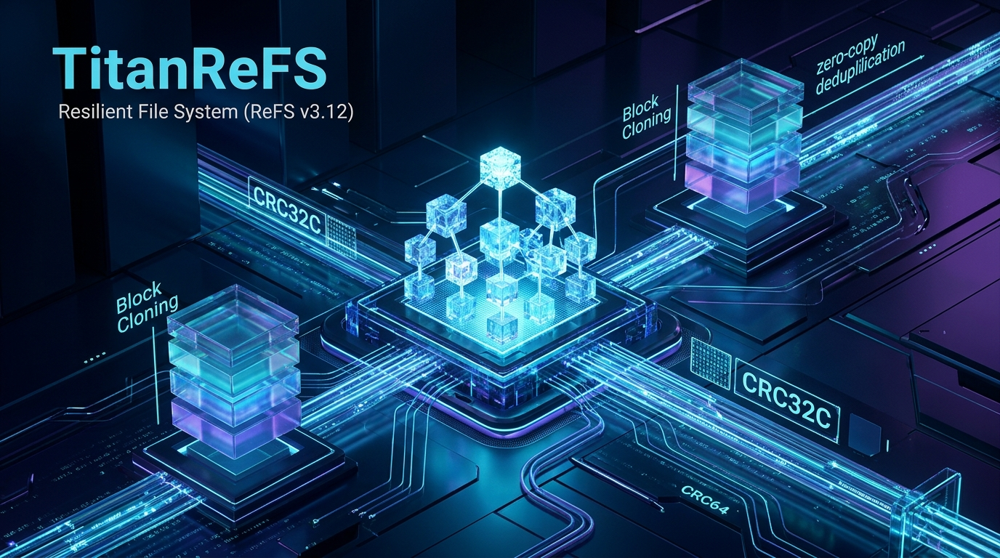

# TitanReFS: High-Performance ReFS v3.12 Engine for Windows

[](https://github.com/MicaNT-Kernel/TitanReFS/actions/workflows/ci.yml)
[](LICENSE)
[]()
[](CLEAN_ROOM_PROVENANCE.md)



**TitanReFS** is an independent, clean-room implementation of Microsoft's **Resilient File System (ReFS v3.12)** designed in modern ISO C++23. It provides native volume formatting, File Explorer drive mounting via WinFsp, background bit-rot scrubbing, and high-performance block cloning for Windows 10, Windows 11 (Home & Pro), Windows Server, and POSIX platforms.

---

## Key Features

- **ReFS v3.12 Architecture**: 64KB cluster allocation with B+ tree tables and exabyte-scale addressing.
- **WinFsp User-Mode Driver Bridge (`titanrefs_mount`)**: Mount any ReFS volume or raw image to standard Windows drive letters (e.g. `R:\`) with native File Explorer, Command Prompt, PowerShell, and application integration.
- **Windows NT Background Service (`titanrefs_svc`)**: Background auto-mount engine and 24-hour autonomous integrity stream bit-rot scrubber with Named Pipe IPC (`\\.\pipe\titanrefs_ipc`).
- **Allocate-on-Write (CoW)**: Out-of-place atomic writes eliminating write holes and ensuring zero-downtime consistency.
- **Hardware-Accelerated Integrity Streams**: Castagnoli CRC32C and CRC64 checksum verification protecting against silent data corruption.
- **Instant Block Cloning (`FSCTL_DUPLICATE_EXTENTS_TO_FILE`)**: Zero-copy extent sharing with atomic reference counting for rapid virtual machine and file duplication.
- **1-Click Standalone Installer (`titanrefs_setup`)**: Single executable embedding all binaries, assets, and the signed WinFsp driver in an LZ4-compressed payload.
- **Strict Clean-Room Provenance**: 100% written from first principles under 17 U.S.C. § 1201(f) interoperability standards, audited by our automated Sentinel.

---

## Utilities & Architecture

### 1. `titanrefs_mount` (User-Mode Filesystem Bridge)
Mounts any raw disk image (`.raw`, `.img`, `.vhdx`) or physical drive to a Windows drive letter:
```bash
# Mount an existing ReFS disk image to R:
titanrefs_mount refs_disk.raw R:

# Format and mount a 512MB ReFS volume with custom label
titanrefs_mount refs_disk.raw R: --format --label Storage --size 512

# Mount physical drive
titanrefs_mount \\.\PhysicalDrive1 R:
```

### 2. `titanrefs_svc` (Windows NT Background Service)
Autonomous service daemon for volume auto-mounting, IPC, and 24-hour bit-rot scrubbing:
```bash
# Register and start as Windows Auto-Start Service
titanrefs_svc install

# Run in interactive console debug mode
titanrefs_svc run

# Uninstall service
titanrefs_svc uninstall
```

### 3. `titanrefs_format` (CLI Formatting Utility)
Format any disk image or physical partition to ReFS v3.12:
```bash
titanrefs_format my_disk.raw --size 256 --cluster 65536 --label "TitanData"
```

### 4. `titanrefs_check` (Scrubber & Volume Inspector)
Inspect on-disk structures (boot sector, superblocks, checkpoints) and verify integrity streams:
```bash
titanrefs_check my_disk.raw
```

### 5. `titanrefs_setup` (Standalone GUI Installer)
Pure Win32 dark-mode GUI installer with Left-Sidebar Studio layout, automatic WinFsp detection, silent driver deployment, PATH configuration, and Windows Add/Remove Programs integration.

---

## Building from Source

### Prerequisites
- CMake 3.24+
- Modern C++23 Compiler (Clang 18+, MSVC 2022 v17.8+, or GCC 14+)
- Ninja build tool (recommended)

### Windows Build (Clang / Ninja)
```bash
cmake -B build -G Ninja -DCMAKE_BUILD_TYPE=Release
cmake --build build -j2
```

### Run Test Battery
```bash
ctest --test-dir build --output-on-failure
# Or directly:
./build/titanrefs_tests
```

### Run Clean-Room Sentinel Audit
```bash
node scripts/clean_room_sentinel.js --local
```

### Create Distribution ZIP
```bash
cpack --config build/CPackConfig.cmake -B build/dist
```

---

## Legal & Clean-Room Architecture
TitanReFS is an independent clean-room implementation developed for functional interoperability under 17 U.S.C. § 1201(f) and SCOTUS fair use doctrine (*Google v. Oracle*). See [CLEAN_ROOM_PROVENANCE.md](CLEAN_ROOM_PROVENANCE.md) for full compliance declarations.

---

## License
Licensed under the Apache License, Version 2.0.  
Copyright © 2026 Daniel Elliott <ssfdre38@gmail.com>.
